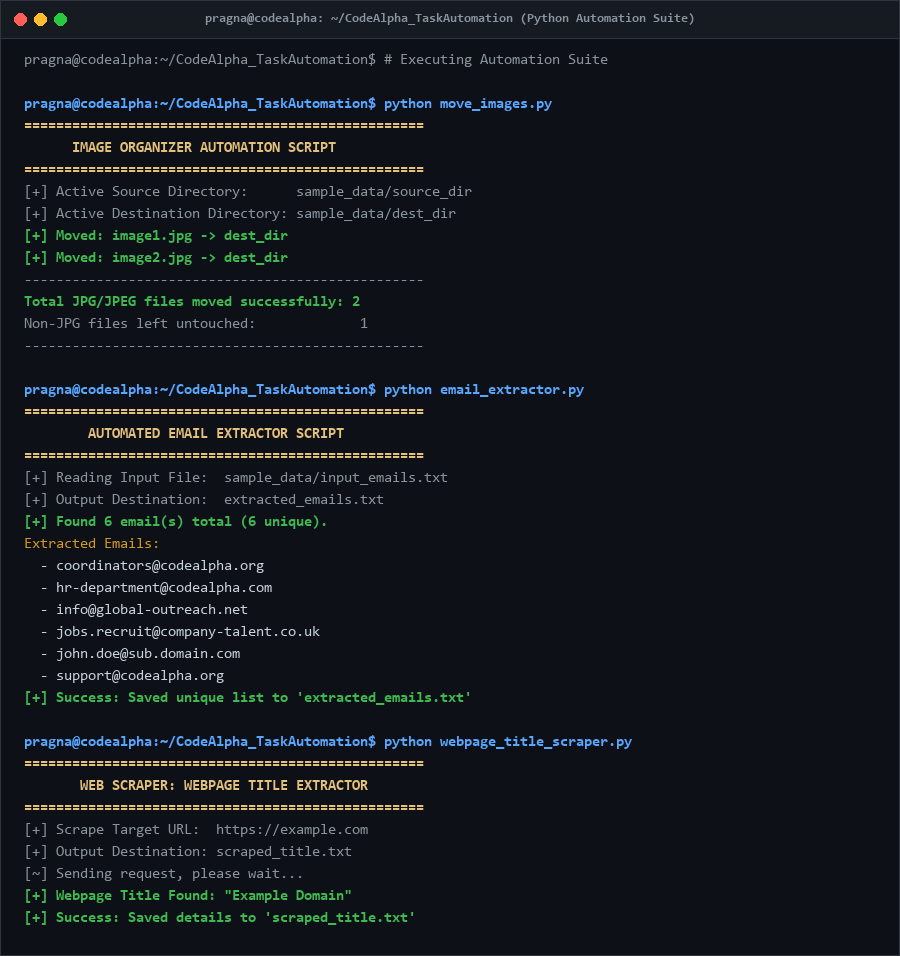

# CodeAlpha Python Programming Internship - Task 3: Task Automation

<div align="center">


</div>

## 📝 Project Overview
This repository contains a complete suite of **Task Automation Scripts** developed in Python for the **CodeAlpha Python Programming Internship (Task 3)**. Instead of completing just one automation idea, this repository implements **all three** recommended real-life tasks:
1. **Image Organizer (`move_images.py`)**: Automatically scans a directory and moves all `.jpg` and `.jpeg` images to a designated destination folder.
2. **Regex Email Extractor (`email_extractor.py`)**: Parses raw text files, extracts all valid email addresses using regular expressions, deduplicates them, and writes a clean list to a file.
3. **Webpage Title Scraper (`webpage_title_scraper.py`)**: Fetches any target webpage, parses its HTML DOM via `BeautifulSoup`, extracts the `<title>` tag, and saves the result to a report file.

---

## 🎯 Task Objectives & Compliance
- [x] **Automation Scope**: Automates real-world repetitive administrative and data-extraction workflows.
- [x] **Includes All 3 Automation Ideas**:
  - Image file moving and directory decluttering.
  - Regex pattern matching for email extraction.
  - Web scraping with HTTP requests and HTML parsing.
- [x] **Key Concepts Implemented**: `os`, `shutil`, `re`, `requests`, `beautifulsoup4`, file I/O handling, and error containment.

---

## 📸 Execution Preview
Below is the verified running screenshot of the Task Automation suite in terminal:

<div align="center">



</div>

---

## ✨ Features

### 1. Image Organizer (`move_images.py`)
- Filters files with `.jpg` and `.jpeg` extensions case-insensitively.
- Safely moves image files using `shutil.move` without affecting other documents.
- Creates target destination directories automatically if they do not exist.
- Provides sample test directories out-of-the-box (`sample_data/source_dir`).

### 2. Regex Email Extractor (`email_extractor.py`)
- Employs an RFC-compliant regex pattern (`r'[a-zA-Z0-9._%+-]+@[a-zA-Z0-9.-]+\.[a-zA-Z]{2,}'`).
- Automatically deduplicates and sorts extracted email addresses.
- Saves the clean email list to `extracted_emails.txt`.

### 3. Webpage Title Scraper (`webpage_title_scraper.py`)
- Sends HTTP GET requests using `requests` with a realistic browser User-Agent header.
- Parses HTML trees using `bs4.BeautifulSoup`.
- Handles connection errors, timeouts, and HTTP status codes cleanly.
- Saves scraped titles to `scraped_title.txt`.

---

## 🛠️ Technologies Used
- **Language**: Python 3.x
- **Standard Libraries**: `os`, `shutil`, `re`, `sys`
- **Third-Party Libraries**: `requests`, `beautifulsoup4`

---

## 📂 Repository Structure
```text
CodeAlpha_TaskAutomation/
│
├── move_images.py              # Script 1: Image Mover & Organizer
├── email_extractor.py          # Script 2: Regex Email Extractor
├── webpage_title_scraper.py    # Script 3: Web Scraper (Title Grabber)
├── requirements.txt            # Third-Party Dependencies
├── README.md                   # Project Documentation & Guide
├── .gitignore                  # Git Ignore File
├── screenshots/
│   └── run_preview.png         # Terminal Running Screenshot
└── sample_data/
    ├── input_emails.txt        # Sample text file for email extraction
    └── source_dir/             # Sample source folder with test images
        ├── image1.jpg
        ├── image2.jpg
        └── notes.txt
```

---

## 🚀 How to Run Locally

### Prerequisites
- Python 3.8 or higher.
- Check Python and pip:
  ```bash
  python --version
  pip --version
  ```

### Step-by-Step Execution
1. **Clone the repository:**
   ```bash
   git clone https://github.com/pragna3101/CodeAlpha_TaskAutomation.git
   ```
2. **Navigate into the directory:**
   ```bash
   cd CodeAlpha_TaskAutomation
   ```
3. **Install dependencies:**
   ```bash
   pip install -r requirements.txt
   ```
4. **Run Script 1 (Image Organizer):**
   ```bash
   python move_images.py
   ```
   *(Press Enter to run on default `sample_data/source_dir`)*

5. **Run Script 2 (Email Extractor):**
   ```bash
   python email_extractor.py
   ```
   *(Press Enter to extract from `sample_data/input_emails.txt`)*

6. **Run Script 3 (Webpage Title Scraper):**
   ```bash
   python webpage_title_scraper.py
   ```
   *(Press Enter to scrape default URL `https://example.com`)*

---

## 👤 Author
- **Pragna Zala**
- **GitHub**: [@pragna3101](https://github.com/pragna3101)
- **Internship**: CodeAlpha Python Programming Intern
